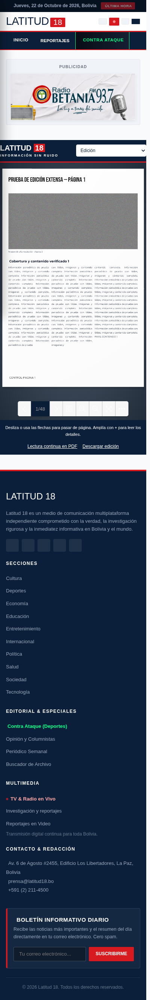
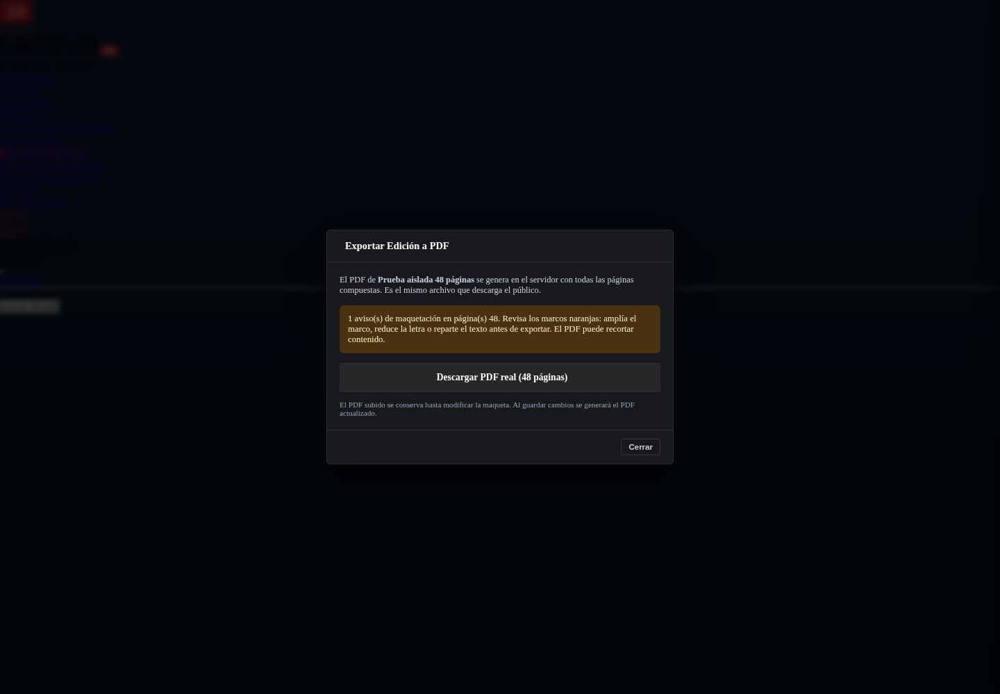

# Validación de Laravel 12, respaldos y periódico

Fecha: 22 de octubre de 2026 (UTC). Entorno aislado Docker con PHP 8.2.34, MySQL 8, GD y ZIP AES-256. El código se actualizó de Laravel 10 a **Laravel 12.70.1** con Sanctum 4, Carbon 3 y PHPUnit 11. Se mantienen las rutas y la estructura de arranque existentes.

## Resultado de comprobaciones

- PHPUnit: **252 pruebas, 16.900 aserciones, todas correctas**, sin advertencias de metadatos. Incluye regresiones de autenticación, programación, noticias, periódico, imágenes y respaldo.
- Frontend: **37 pruebas JavaScript correctas**.
- Build Vite 7, validación de Composer, requisitos de plataforma y comprobación de producción: correctos en el entorno local.
- Caché de dependencias preparada con 125 archivos oficiales; autoload optimizado generado sin el controlador obsoleto.

## Cambios comprobados

- Compatibilidad con Laravel 12: configuración de Sanctum, fechas con Carbon 3 y escape de `@context` en JSON-LD para evitar que Blade lo interprete como una directiva.
- Dependencias de frontend actualizadas y assets compilados incluidos. Se retiró un controlador antiguo sin referencias, con un error de sintaxis y namespace incompatible; las noticias usan el controlador activo de administración.
- Respaldo privado cifrado y ensayo de restauración en otra base, con hashes y recuentos. Los comandos se niegan a restaurar sobre la base activa o la original y rechazan rutas inseguras del ZIP.
- Copias optimizadas de fotografías para el PDF, límite de megapíxeles y reducción de resolución en ediciones con muchas imágenes. Los originales permanecen intactos.
- Avisos de texto desbordado y objetos fuera del papel, incluyendo páginas ocultas. Se muestran antes de exportar y se pide confirmar al publicar una edición con avisos. Guardar un borrador conserva todo su contenido.
- Fallo real del visor corregido: CSP impedía cargar las texturas `blob:` de DearFlip. Se permite ese recurso únicamente en las rutas públicas del periódico, incluyendo el PDF de alternativa.

## Respaldo y recuperación

Se creó una copia cifrada de la base local y de los archivos antes de cargar las imágenes de estrés. Se restauró en una base MySQL diferente y una carpeta privada, sin sobrescribir el sitio:

| Comprobación | Resultado |
|---|---|
| Tablas restauradas | 20; recuentos idénticos |
| Archivos incluidos | 38; tamaño y SHA-256 idénticos |
| Contenido de noticias | Hash del conjunto de registros idéntico |
| Cifrado | AES-256, también el manifiesto |
| Conexión del ensayo | CA y nombre del servidor verificados |

Esto demuestra el funcionamiento local del mecanismo. La copia completa y la recuperación del servidor cPanel aún requieren ejecutarse allí siguiendo [la guía de operación](laravel12-respaldo-cpanel.md). La copia cifrada, su contraseña y el `.env` restaurado permanecen en ubicaciones privadas y no se incluyen en Git.

## Ediciones grandes

Se generaron páginas de 280 × 430 mm con titular, foto, artículo a tres columnas y pie de control. `pdfinfo` confirmó **48 páginas**. La extracción con `pdftotext` encontró los 48 pies y los 48 marcadores finales del artículo; no faltó ningún marcador.

| Caso | Tiempo | PDF | Memoria PHP máxima |
|---|---:|---:|---:|
| 48 páginas, misma foto de 4000 × 3000, antes de optimizar | 2,88 s | 8.928.064 bytes | 79,6 MB |
| Mismo caso, copia optimizada, caché fría | 5,11 s | 3.217.583 bytes | 110,5 MB |
| 48 páginas, 48 archivos de foto distintos, límite de 1600 px | 47,39 s | 42.565.628 bytes | 173,6 MB |

Las fotografías de estrés usan ruido de alta complejidad, unos 8 MB por original. En el caso de 48 archivos se usaron los mismos píxeles con rutas y hashes distintos para forzar su inclusión separada. El resultado no representa el tamaño habitual de una foto periodística. La reducción del primer caso fue del **64 %**. La generación se ejecutó con un límite PHP de 256 MB. Un servidor más lento puede necesitar más tiempo; medir también sus límites de CPU, memoria y ejecución.

## Visor y desbordamiento

Chromium con WebGL por software, a **360, 390, 768 y 1440 px**: PDF de 48 páginas, texturas cargadas en portada, página siguiente y última página, sin errores JavaScript ni bloqueos de CSP. Se comprobó ausencia de desbordamiento horizontal de la página. Cada caso tardó aproximadamente 9–14 segundos en cargar y navegar hasta el final en este entorno.

Se inyectó un fallo del motor 3D después de obtener el PDF: apareció la alternativa PDF dentro de la página y el reintento en **2D dibujó las páginas**. Una respuesta HTTP 503 del documento mostró el error y las opciones para reintentar o abrir el PDF.

El editor se abrió con 48 páginas. Se introdujeron 1200 repeticiones de texto en un marco de la página 48 oculta: apareció el aviso indicando esa página. Al sustituirlo por texto breve desapareció. Esta comprobación mide el diseño del navegador; la revisión visual del PDF sigue siendo necesaria por las diferencias de fuentes y columnas con DomPDF.





**No se usaron teléfonos físicos ni Safari de iOS.** Probar en Android y iPhone reales, incluyendo orientación, zoom y redes móviles, sigue pendiente. Tampoco se ha ejecutado el despliegue en cPanel.

## Dependencias y límites de la auditoría

- Composer: 125 paquetes contrastados con la base oficial FriendsOfPHP/security-advisories; 92 avisos aplicables a sus nombres revisados, **0 coincidencias de versión vulnerable**. El endpoint habitual `composer audit` respondió 403 por la red del entorno; se usó la base descargada desde su repositorio oficial, sin desactivar TLS.
- `npm audit --omit=dev`: **0 vulnerabilidades** entre las dependencias declaradas de producción. Axios, que se compila desde una dependencia de desarrollo, también se actualizó a **1.20.0** mediante `npm audit fix`.
- Auditoría npm completa: **15 advertencias pendientes, 5 altas y 10 moderadas**, en Tailwind 3, cssnano 6 y sus herramientas de compilación. Resolverlas requiere revisar la migración de esas herramientas y comparar visualmente el CSS resultante. No se declara que todas las dependencias estén libres de avisos.
- Laravel 12 recibe seguridad hasta el **24 de febrero de 2027**. Programar la siguiente actualización antes de esa fecha; Laravel 13 requiere PHP 8.3 o superior.

## Repetir comprobaciones

Con dependencias instaladas y una base MySQL de pruebas aislada y configurada:

```bash
DB_DATABASE=BASE_DE_PRUEBAS php vendor/bin/phpunit
node --test tests/Frontend/*.test.cjs
npm run build
php scripts/check-production.php
composer check-platform-reqs --no-dev
```

Nunca ejecutar los tests que reconstruyen la base de datos contra producción. Los tests de frontend necesitan las dependencias de `tests/Frontend/package.json`. Los ensayos de respaldo y las comprobaciones posteriores al despliegue están en [la guía de cPanel](laravel12-respaldo-cpanel.md).
